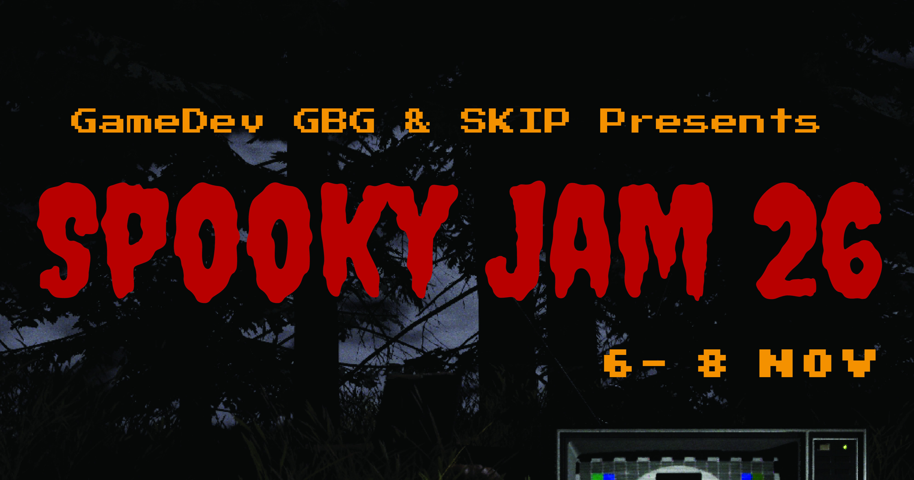
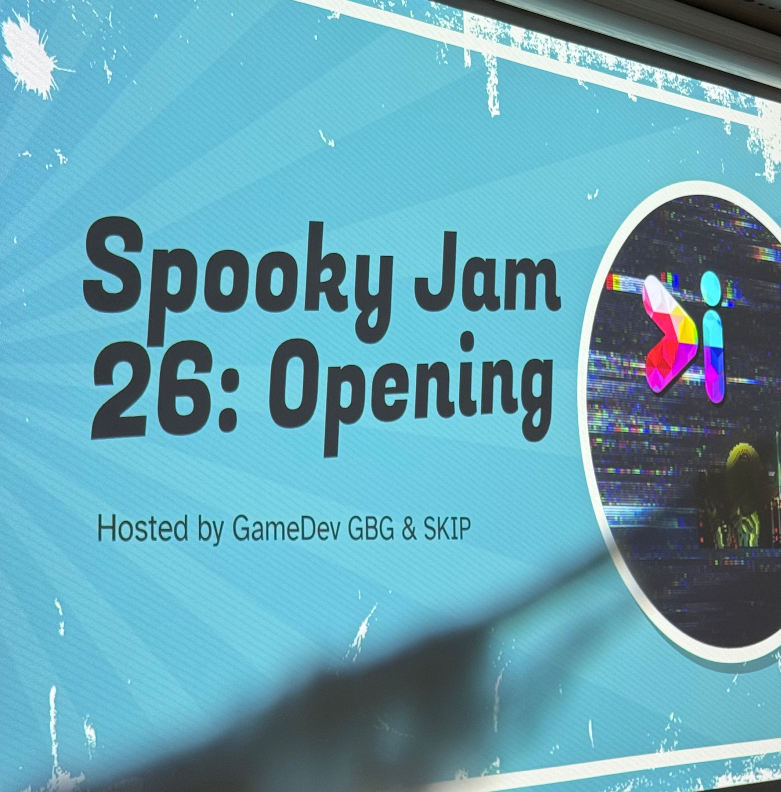
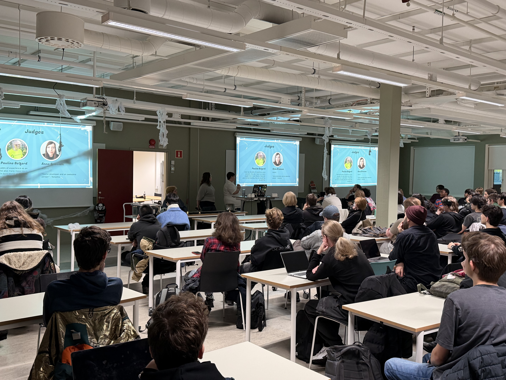
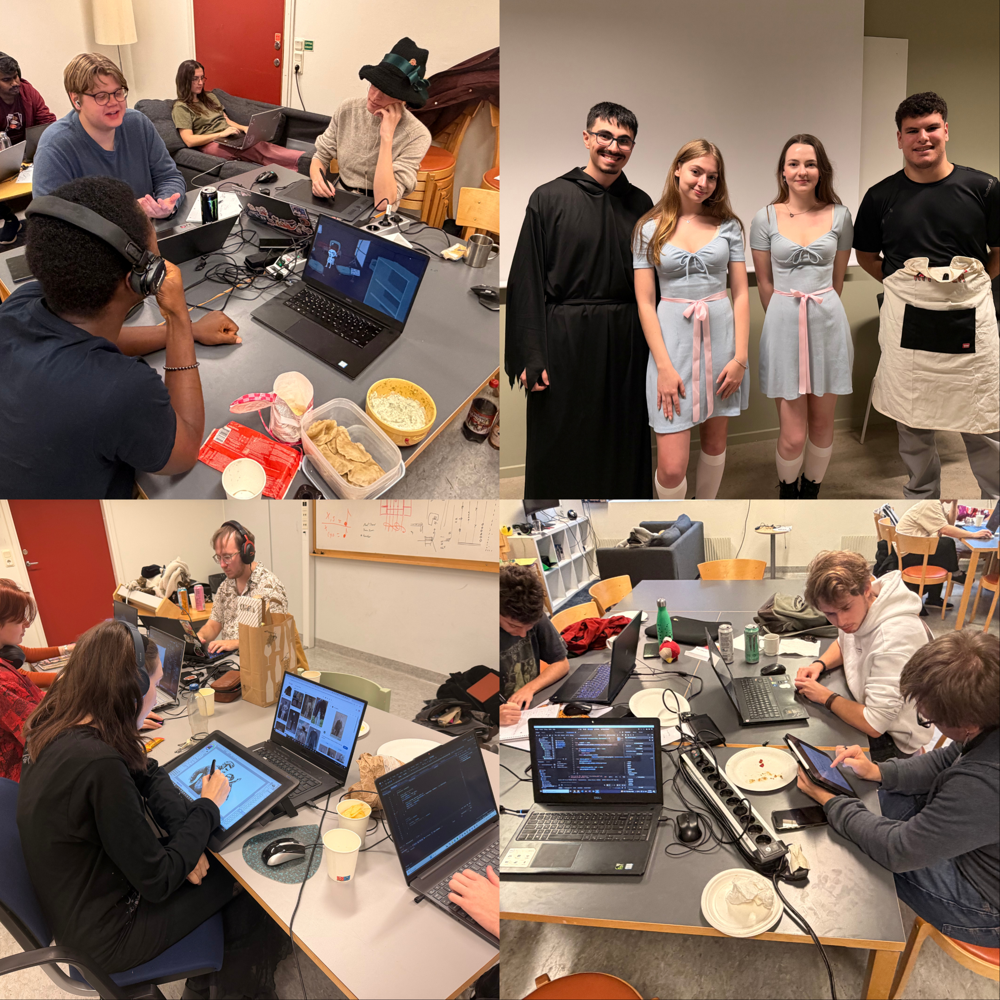
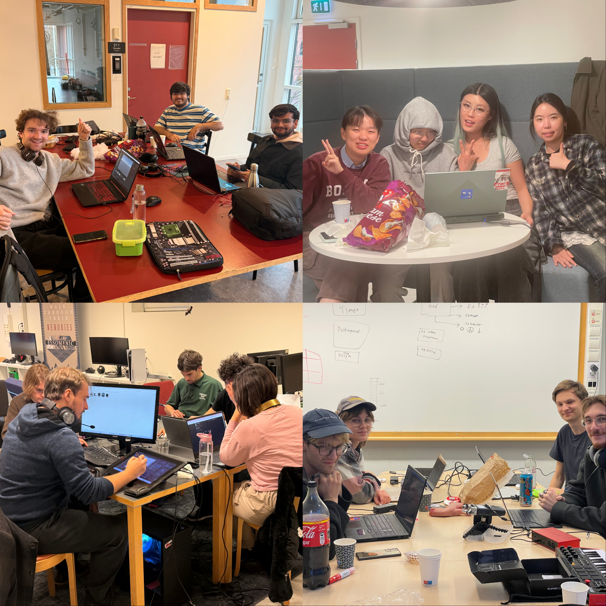
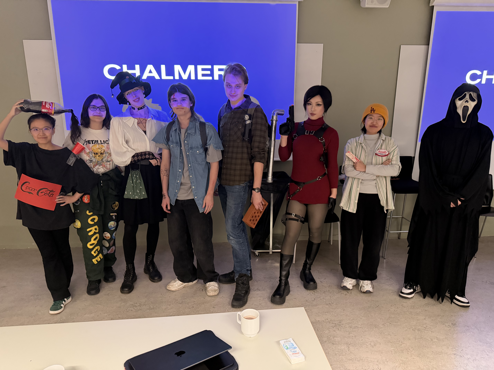
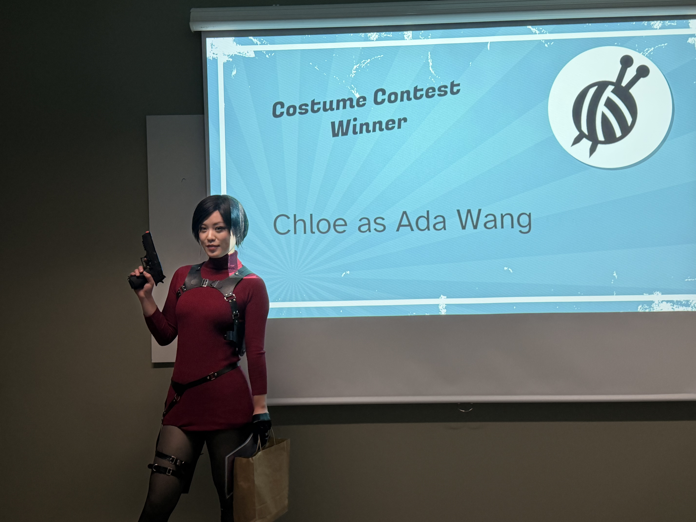
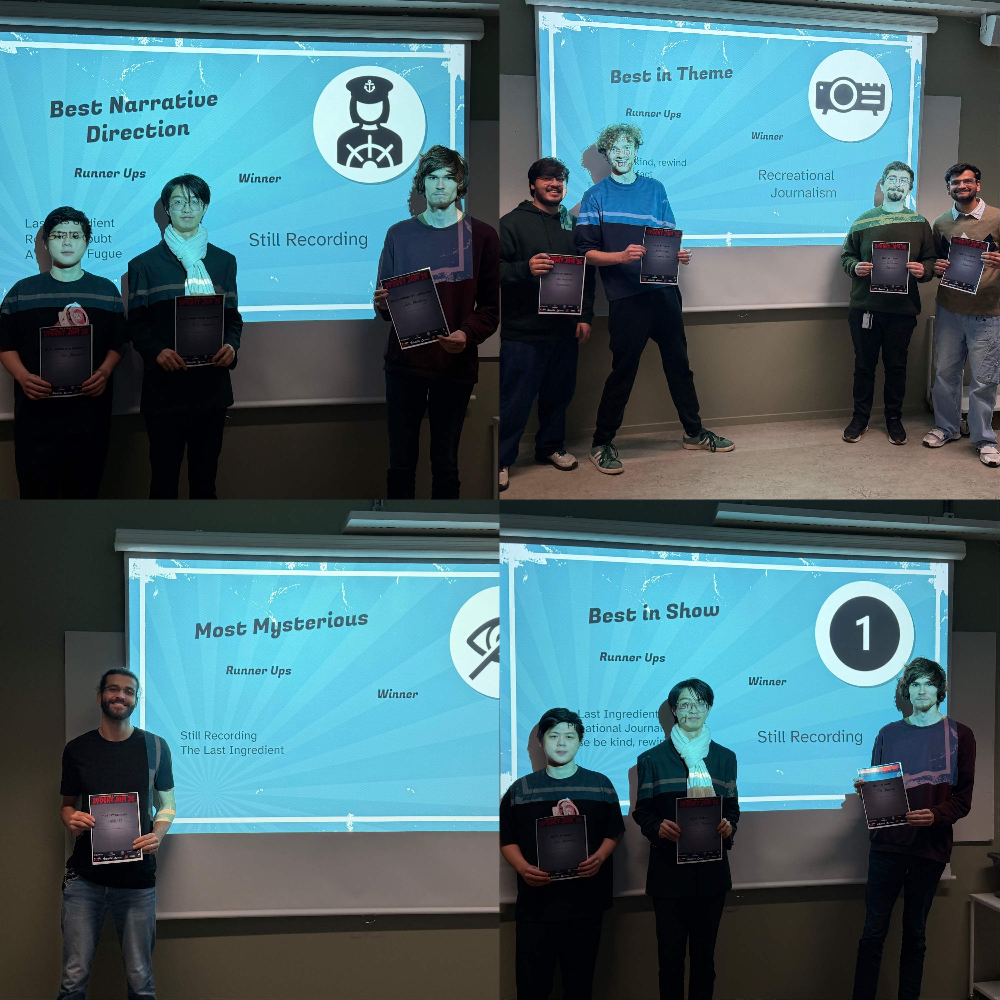

After a very long time, we have collaborated with GameDevGBG to organize another edition of the Spooky Game Jam 2026. This year, the jam took place during the 6-8th November weekend.

The weekend started with some opening words from GameDevGBG and SKIP, followed by the schedule, introduction of the judges, and the theme. The theme of the jam was 'Lost Footage', and each team had the opportunity to create a game according to their own vision.

After the opening words, the teams got to thinking about how to tackle the theme and jamming.

On Sunday, teams submitted their games for the live gameplay judging session. Every team provided a creative and spooky game to try out! You can also try out the games for yourself here.

After the live gameplay session of **36 games**, the costume session run by us started, and many participants showed off their carefully crafted costumes and then voted for the winner!

Whose winner was Yuxi Guo with their cosplay of Ada Wong:

After the costume contest, the winners of the game jam were announced for the following categories:

Most Mysterious:
[**Lake2631**](https://buddhadom.itch.io/lake)

Best Narrative Direction: [**Still Recording**](https://donglin-unirus-yan.itch.io/lost-footage)

Best Art Direction: [**Black Sun**](https://jonelsmis.itch.io/black-sun)

Best in Theme: [**Recreational Journalism**](https://hatinc.itch.io/recreational-journalism)

Best in Show: [**Still Recording**](https://donglin-unirus-yan.itch.io/lost-footage)

Thank you Natasha & GameDevGBG for allowing us to organize this jam with you and all the participants for creating a variety of games! We hope to organize more events with you all in the future!
