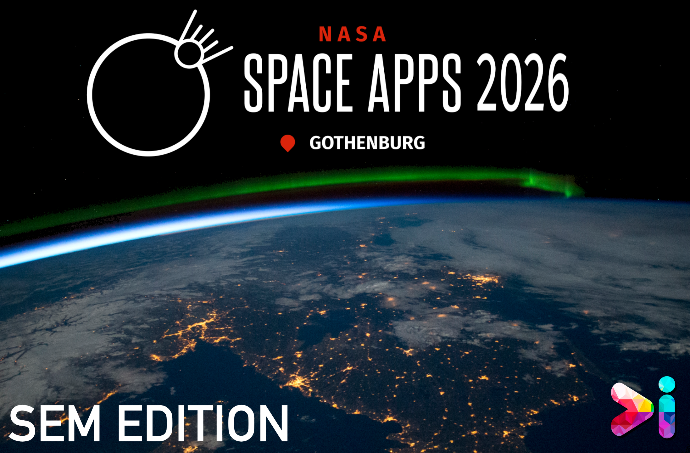

On the weekend on 14-15th November 2026, NASA (USA's National Aeronautics and Space Administration) organized an annually recurring global hackathon called the NASA International Space Apps Challenge. As a part of this hackathon, numerous organizations and partners organize in cooperation and training from NASA, local events all around the world. During the past few years, the local round of this hacakthon in Gothenburg was organized in [YESBOX](https://www.yesboxgoteborg.se/) by a company Beyond Gravity. However, because the hackathon was globally moved to November, the organizers did not have the resources and time to do it this weekend and thus the Gothenburg local round did not take place. We see this hackathon as an entry/first hackathon for many of our first-year students in Software Engineering and Management Bachelors programme, so the SKIP board has decided to organize our own local unofficial round at Campus Lindholmen, in Lecture Room Alfons, House Jupiter to deliver this experience again to our students - and they delivered a bunch of creative and intiguing projects challenging various provided Challenges.

The topic for this year's hackathon was ***"The Next Frontier"*** where NASA provided open data in many different formats to allow for unlimited possibilities. Our students organized themselves into teams and after the initial ceremony strived to create innovative projects that tackled one of the many intriguing [challenges](https://www.spaceappschallenge.org/2026/challenges/)! 

We are happy that we had a variety of representation from both Bachelors and Masters programmes in Software Engineering and Management (Both University of Gothenburg and Chalmers University of Technology), SKIP members, and even a group composed of a visiting researcher trying to solve various challenges, from storytelling to creating a maping and navigation system for other planets. During the entire weekend, we have been serving various snacks and minipizzas to fuel and motivate the participants. On the second day, Sunday 15th November, all teams gathered and then presented and showcased their demos to our judging panel consisting of:
- **Aris Alissandrakis** - a Senior Lecturer at Chalmers University of Technology representing the **Academical** aspect
- **Máté Stier** - a 3rd year SEM student and a Technical Lead in SKIP representing the **Technical** aspect
- **Taylor Mohylsky** - a Business Developer at Chalmers' Founders Loft representing the **Business** aspect

More photos can be found on our Social Media.

Thank you all for participating in the **SEM Edition of the NASA Space Apps Challenge 2026!** The judges were impressed by the students' projects and the following are the winners

In Categories:
- **Technical Complexity and Use of Data**: **Unknown Entities**
  - 2nd year SEM students who worked on an ambitious challenge - how to create a navigation system on Mars.
- **Real-life Applications**: **Junior Jr Bosses**
  - 1st year SEM students who just started university 2 month before the hackathon. They have worked on a project that dealt with the Astronaut's health and data, a system giving the Astronaut a way of how to log their health data and get advice back.

**Congrats to all the winners and participants for creating stunning projects!**

